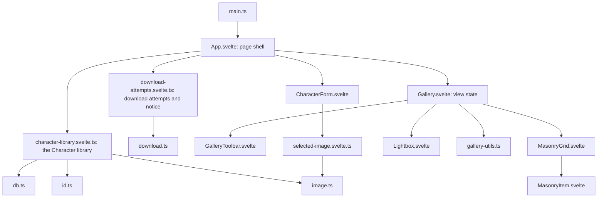

# Character Gallery: Developer Wiki

> This document describes the current codebase. Read it before you change the code.
> It uses short sentences and the active voice, as `docs/ASD-STE100-LLM-Writing-Rules.md` recommends.
> For a machine-readable summary, see `docs/LLM-WIKI.md`. For the layout design, see `docs/designMasonry.md`.

## 1. Overview

The Character Gallery is a browser-only application. It stores character cards in IndexedDB. A card holds a name, a description, and an image. The app shows the cards in a masonry gallery, with search, sort, batch delete, and a detail view. The app can export one image as a PNG file.

The app has no backend. It has no runtime dependencies. All entries in `devDependencies` are build tools or test tools.

## 2. Quick Start

Requirements: Node.js `^24.15.0 || ^26.0.0` and npm `^12.0.0`. `package.json` declares both ranges, and `package-lock.json` repeats them at the root of the lockfile. Node 26 is the preferred version for local development, and `.nvmrc` selects it. Node.js runs the local tools and the launcher. The built app is static files. No local install step and no launcher rejects an unsupported version. See the [README requirements](../README.md#requirements) for the full statement.

| Command | Action |
|---|---|
| `npm install` | Install the dependencies. |
| `npm start` | Build the bundle if `dist/` is stale, serve it on port 4173, and open the browser. |
| `npm run start:dev` | Start the Vite development server through the launcher. |
| `npm run dev` | Start the Vite development server on port 5173. |
| `npm run build` | Build the production bundle into `dist/`. This command does not type-check. |
| `npm run preview` | Serve the built bundle. |
| `npm run check` | Run `svelte-check` one time. This command type-checks `src` and `tests`. |
| `npm run check:watch` | Run `svelte-check` in watch mode. |
| `npm test` | Run the Vitest suite one time. |
| `npm run test:watch` | Run the tests in watch mode. |
| `npm run test:ui` | Open the Vitest user interface. |

Run `npm run check`, `npm test`, and `npm run build` before you push. Continuous integration runs the same three commands on every push to `main` and every pull request. It tests six Node and npm combinations. Each combination installs the locked dependencies with engine enforcement, then type-checks, tests, and builds. See `.github/workflows/ci.yml`. The repository has no linter and no formatter. See `CONTRIBUTING.md` for the merge expectations.

The launcher in `scripts/start.mjs` takes `--dev`, `--port <n>`, `--host`, `--force`, `--no-build`, `--no-open`, and `--help`. On Windows, `start.cmd` does the same from a double click.

To reset the local data, open the browser devtools, go to **Application > IndexedDB**, and delete the `character-gallery` database. You can also run `indexedDB.deleteDatabase('character-gallery')` in the console.

## 3. Technology Stack

| Area | Choice | Notes |
|---|---|---|
| UI and state | Svelte 5 | Runes only (`$state`, `$derived`, `$props`, `$effect`). No stores. |
| Build | Vite 6 | `vite.config.ts`. Root is the repository root. |
| Styles | Tailwind CSS 4 | Through the `@tailwindcss/vite` plugin. Theme tokens live in `src/style.css`. |
| Types | TypeScript 5.6 | Strict mode plus `noUnusedLocals`, `noUnusedParameters`, `noFallthroughCasesInSwitch`. |
| Storage | IndexedDB | No library. The wrappers are in `src/db.ts`. |
| Tests | Vitest 5 + jsdom | `environment` is `node` by default. DOM tests opt in per file. |

## 4. Architecture

The app is one page with six layers: the entry point, the page shell, the stateful modules, the view components, the pure helpers, and the storage layer.



Rules of the design:

- `character-library.svelte.ts` owns the database connection and the canonical `characters` list. It is the only writer of Character records. `App.svelte` reads the list and renders it. It never builds a record, preserves a creation time, or reloads the library after a save.
- `Gallery.svelte` owns everything about the view: search, sort, paging, selection, and the identity of the open Character. It keeps `selectedId` as state and derives the open Character from the canonical list, so the dialog never shows a copy that can go stale.
- Child components receive data and callbacks through props. They never import the database.
- The pure helpers (`gallery-utils.ts`, `download.ts`, `id.ts`, `image.ts`) hold no component state. `selected-image.svelte.ts`, `character-library.svelte.ts`, and `download-attempts.svelte.ts` are stateful modules; one `SelectedImage` belongs to one form draft, and one `CharacterLibrary` and one `DownloadAttempts` belong to one page lifetime.
- `Gallery.svelte` and `Lightbox.svelte` do not download anything themselves. Each reports the Character the user asked to download through `onDownload`, so the page keeps the attempt and its notice when the Gallery is torn down.
- `CharacterForm.svelte` owns the text fields, the save action, and the save-time locking. `SelectedImage` owns the image choice, its dimensions, readiness, and recovery. `CharacterLibrary` owns identity, creation time, the size pair rules, and delete outcomes.

### Data flow for a save

1. `CharacterForm.svelte` collects the name and the description. Its `SelectedImage` instance reads the chosen file, measures it, and decides whether the draft can be saved.
2. The form takes a plain snapshot from the preparation module and calls `onSave`, which is `App.handleSave`.
3. `App.handleSave` passes the draft to `CharacterLibrary.save`. It does not build the record.
4. The library assembles the record inside its serialized operation chain and commits it with `dbAdd`.
5. Only after the storage transaction commits, the library publishes the committed record into the canonical list. There is no full-library reload after a mutation.
6. `Gallery.svelte` derives the filtered, sorted, and paged list from the new array.

A rejection reaches the form, which keeps the draft and shows its own message. A resolution means the record is committed and published.

## 5. Source Layout

| Path | Purpose |
|---|---|
| `index.html` | HTML entry page. It loads `src/main.ts`. |
| `src/main.ts` | Mounts `App` into `#app` and imports `style.css`. |
| `src/App.svelte` | Page shell. Renders the start-up, failure, and ready states, the delete and download notices, and the form or gallery. No storage knowledge. |
| `src/types.ts` | The `Character` interface. |
| `src/character-library.svelte.ts` | `CharacterLibrary`, the only writer of Character records and the owner of the canonical list. |
| `src/library-error.ts` | `LibraryError` and `LibraryErrorKind`, with no storage imports, so a component can branch on an error kind without the database. |
| `src/db.ts` | IndexedDB schema and the read and write functions. |
| `src/id.ts` | `generateId`. |
| `src/image.ts` | `measureImage`, which reads the intrinsic size of an image. |
| `src/image-frame.ts` | The frame rule for every image view: the stored size pair, the 4:3 fallback, and the check that a failure still describes the displayed source. |
| `src/selected-image.svelte.ts` | `SelectedImage`, the form-owned selected-image preparation module. |
| `src/download-attempts.svelte.ts` | `DownloadAttempts`, the page-owned download attempts and their failure notice. |
| `src/gallery-utils.ts` | Page size, the sort type, and the search and sort rules. |
| `src/download.ts` | Data URL parsing, PNG conversion, file name rules, and the download action. |
| `src/style.css` | The Tailwind import and the color theme. |
| `src/components/Gallery.svelte` | View state, paging, selection, lightbox state, empty and no-match states. |
| `src/components/GalleryToolbar.svelte` | Search box, sort control, selection controls. |
| `src/components/MasonryGrid.svelte` | Column layout, keyed list, animation. |
| `src/components/MasonryItem.svelte` | One card: image, hover label, download button, selection box. |
| `src/components/Lightbox.svelte` | Detail dialog with keyboard and button navigation. |
| `src/components/CharacterForm.svelte` | Add and edit form. |
| `tests/` | Vitest files and helpers. See section 11. |
| `scripts/start.mjs` | The `npm start` launcher. It checks the age of `dist/`, builds when needed, and serves the result. |
| `scripts/ci-gate.mjs` | The fail-closed check gate. It reads the triggering run's job and step conclusions, requires the steps declared in `.github/required-contexts.json`, and publishes the required check. See `docs/branch-gate.md`. |
| `start.cmd` | Double-click launcher for Windows. It installs dependencies on the first run. |
| `docs/` | This wiki, the LLM wiki, the branch gate, the layout design, and the writing rules. |
| `README.md` | The public entry point. Features, setup, and the data model in plain terms. |
| `LICENSE`, `NOTICE` | The Apache-2.0 license and the attribution file. |
| `CONTRIBUTING.md` | Setup, conventions, the commit format, and the pull request process. |
| `CHANGELOG.md` | Release history in Keep a Changelog form. |
| `.github/` | CI, CodeQL, dependency review, the gate workflow and its required contexts, the main-branch ruleset payloads, Dependabot, and the issue and pull request templates. |

## 6. Data Model

`src/types.ts` defines one interface:

```ts
export interface Character {
  id: string;          // IndexedDB key path. Opaque. Never shown to the user.
  name: string;        // Required. Shown on the card and in the lightbox.
  description: string; // Optional. Searched and shown in the lightbox.
  image: string;       // Required. Base64 data URL, for example "data:image/png;base64,...".
  width?: number;      // Intrinsic width in pixels. Optional for an old record.
  height?: number;     // Intrinsic height in pixels. Optional for an old record.
  createdAt: number;   // Milliseconds since the epoch. Set once.
}
```

Rules:

- `width` and `height` must describe `image`. A usable pair reserves the card shape before the image decodes. A pair that is not both finite and positive does not: every image view uses the complete 4:3 fallback instead, so a wrong value shows the wrong shape but never one stored side paired with one fallback side. See `src/image-frame.ts`.
- When the size is unknown, leave both fields empty. `CharacterLibrary` measures them in the background after start-up.
- `createdAt` never changes after the first save. `CharacterLibrary` copies the stored value during an edit, so the sort order stays stable.

## 7. Storage Layer

The database name is `character-gallery`. The name is a default in `character-library.svelte.ts` and a literal only in tests. The version is `1`. The version constant lives in `src/db.ts`.

The object store is `characters`. The key path is `id`. The store has one index, `name`, which is not unique. No query uses the index today. The list is read with `getAll` and sorted in memory.

### Functions in `src/db.ts`

| Function | Contract |
|---|---|
| `openDB(dbName: string): Promise<IDBDatabase>` | Opens the database at version 1. On the first open, the upgrade handler creates the store and the `name` index. |
| `dbAdd<T>(db, item): Promise<void>` | `put`, so the call inserts or replaces a record. Resolves on commit. |
| `dbDelete(db, id): Promise<void>` | Deletes one record. Deletes of a missing id succeed. |
| `dbDeleteMany(db, ids): Promise<void>` | Deletes many records in one transaction. An empty array is allowed. |
| `dbGetAll<T>(db): Promise<T[]>` | Reads every record in key order. |

The private helper `awaitTransaction` attaches `oncomplete`, `onerror`, and `onabort`. A transaction that aborts fires only `abort`, so a handler for `abort` is necessary. Without it, a caller can wait forever.

### How to change the schema

1. Increase `DB_VERSION` in `src/db.ts`.
2. Add the change in the `onupgradeneeded` handler. Guard a new store or index with a `contains` test, as the current code does.
3. Give old records a default value in the `CharacterLibrary` record rules or in its background repair. Keep the repair's freshness check: it writes only into the record as it stands now.
4. Update `tests/db.test.ts`. Add a test that opens an old version and then runs the upgrade.

## 8. Module Reference

### `src/id.ts`

```ts
export function generateId(): string;
```

Uses `crypto.randomUUID()` when the browser supplies it. Otherwise the function returns the current time in base 36 plus a random value. The fallback covers plain HTTP origins, where `crypto.randomUUID` is absent.

### `src/image.ts`

```ts
export function measureImage(src: string): Promise<{ width: number; height: number }>;
```

Loads the source in an `Image` element and resolves with `naturalWidth` and `naturalHeight`. The promise rejects when the image does not load. The function reads the image again from the data URL, so the browser does not need a network request.

### `src/image-frame.ts`

```ts
export const FALLBACK_IMAGE_SIZE = { width: 4, height: 3 };
export const IMAGE_UNAVAILABLE_TEXT = 'Image unavailable';
export function isUsableImageSize(size: { width?: number; height?: number } | null | undefined): size is { width: number; height: number };
export function imageFrameSize(size: { width?: number; height?: number } | null | undefined): { width: number; height: number };
export function imageFrameAspectRatio(size: { width?: number; height?: number } | null | undefined): string;
export function failedImageSource(event: Event): string | null;
export function isImageUnavailable(source: string, failedSource: string | null): boolean;
```

One display rule for the card and the lightbox:

- `isUsableImageSize` is true only when both stored numbers are finite and greater than zero. A missing, zero, negative, or non-finite half says nothing reliable about the image, so it supplies neither side of the frame. It is a type predicate, so `imageFrameSize` narrows the stored pair instead of asserting it.
- `imageFrameSize` and `imageFrameAspectRatio` return the stored pair when it is usable, and the complete 4:3 fallback otherwise. A stored dimension is never paired with a fallback one.
- The rule is for display only. It reads the Character and writes nothing, so a record with an unusable pair keeps that pair until an edit replaces it.
- `isImageUnavailable` answers whether a recorded failure still describes the image on screen. A failure is recorded as the source string that failed, so replacing `character.image` clears it, including under the same Character id, and a late error from a replaced source cannot mark its replacement.
- `failedImageSource` is the one place the failing element's source is read. The card and the lightbox record a failure against that string and keep their own state; the lightbox adds its own gate on the Character it shows.

### `src/character-library.svelte.ts`

```ts
export const REPAIR_WARNING = 'Some stored images could not be measured. ...';
export type LibraryStatus = 'loading' | 'ready' | 'failed';
export interface CharacterDraft {
  id?: string;
  name: string;
  description: string;
  image: string;
  width?: number;
  height?: number;
}
export interface CharacterLibraryDeps {
  openDatabase?: (name: string) => Promise<IDBDatabase>;
  readAll?: (database: IDBDatabase) => Promise<Character[]>;
  write?: (database: IDBDatabase, character: Character) => Promise<void>;
  remove?: (database: IDBDatabase, id: string) => Promise<void>;
  removeMany?: (database: IDBDatabase, ids: string[]) => Promise<void>;
  measure?: (src: string) => Promise<{ width: number; height: number }>;
  generateId?: () => string;
  now?: () => number;
  databaseName?: string;
  logger?: Pick<Console, 'warn' | 'error'>;
}

export class CharacterLibrary {
  constructor(deps?: CharacterLibraryDeps);
  readonly characters: Character[];
  readonly status: LibraryStatus;
  readonly failureMessage: string | null;
  readonly repairWarning: string | null;
  initialize(): Promise<void>;
  save(draft: CharacterDraft): Promise<void>;
  remove(id: string): Promise<void>;
  removeMany(ids: string[]): Promise<void>;
  dispose(): void;
}
```

One instance belongs to one page lifetime. It is the only writer of Character records and the only owner of the canonical list. The module hides these rules from the page shell:

- `initialize` waits for writes accepted before the call to commit, then opens the database and reads every record outside the commit chain. The same call serves the first start and Retry. `status` moves from `loading` to `ready`, or to `failed` with `failureMessage` and an empty list. The publication joins the chain, and the current list stays until the read replaces it. A later `initialize` supersedes an earlier one: it does not wait for an older pending read, and an older read cannot publish after it.
- `save`, `remove`, and `removeMany` reject with the `unavailable` kind before readiness and after disposal. An unavailable library never queues work for later.
- Every commit and its in-memory publication are one step on a serialized chain, so acceptance order is commit order. A failed step never poisons the chain. An older result cannot land after a newer one.
- `save` assembles the record: a fresh identity on create, the stored identity and creation time on an edit. An edit whose identity is not in the canonical list rejects with `missing-target` and writes nothing. A draft with no complete pair supplies no size, and a partial pair collapses to no size. When no size is supplied and the image is unchanged, the stored pair is kept; otherwise the record has no size. A copied draft is used, so a later form change cannot alter a save already in flight.
- A resolved mutation means the storage transaction committed and the record is published. A rejection means nothing was committed. A `write-failed` error carries the storage error in `cause`.
- Background repair measures a record without a size outside the chain and enqueues only the short write. The write re-checks that the record still exists, still shows the measured image, is still the same image generation, and still has no size. It merges the pair into the current record, so a newer name or description always wins. Attempts are bounded once per identity and image generation per initialized lifetime. A failure logs the Character name and sets one `repairWarning`.
- `dispose` marks the instance inactive. Later repairs and publications do nothing, new mutations reject, an accepted write still commits and settles, and the connection closes after the chain drains.

The default dependencies are the helpers in `db.ts`, `id.ts`, and `image.ts`. The default database name is `character-gallery`. The optional dependencies let tests control a failing open or read, hold a write, complete a measurement later, and fix the clock.

`LibraryError` and `LibraryErrorKind` are declared in `src/library-error.ts` and re-exported here, so the library's public surface stays in one place. A component that only needs to branch on the error kind imports `src/library-error.ts` and never pulls `db.ts` into its own module graph.

### `src/selected-image.svelte.ts`

```ts
export type PreparationStatus = 'idle' | 'preparing' | 'ready' | 'failed';
export interface ImageSnapshot { image: string; width?: number; height?: number; }
export interface SelectedImageDeps {
  readFile?: (file: File) => Promise<string>;
  measure?: (src: string) => Promise<{ width: number; height: number }>;
}

export class SelectedImage {
  constructor(initial: ImageSnapshot | null, deps?: SelectedImageDeps);
  readonly image: string;
  readonly status: PreparationStatus;
  readonly error: string | null;
  readonly warning: string | null;
  readonly canSubmit: boolean;
  readonly hasReplacement: boolean;
  select(file: File): void;
  discard(): void;
  snapshot(): ImageSnapshot | null;
  dispose(): void;
}
```

One instance belongs to one form draft. The module hides these rules from the form:

- The latest `select` call is authoritative. A generation token is checked before every asynchronous success, failure, and warning, so obsolete work cannot change the preview, dimensions, readiness, or feedback.
- While a replacement is prepared, the stored image stays visible and the old dimensions, the submission snapshot, and readiness are cleared. A ready preview, its dimensions, and the snapshot stay paired. A failed measurement leaves both dimensions undefined instead of reusing another image's size.
- `status` stays `preparing` until both the read and the measurement settle. `canSubmit` is true only for `idle` or `ready` with an image present, so a pending or failed replacement blocks saving.
- A read failure sets `status` to `failed`, keeps the stored image visible behind the error, and blocks saving until `discard` or another `select`.
- `discard` returns to the stored image and its known dimensions, or to no image on the add form. It invalidates outstanding work first.
- `dispose` invalidates every outstanding result. The form calls it on unmount.
- `snapshot` returns a copy, so a draft in flight cannot change after submission starts.

The default dependencies are `FileReader` and `measureImage`. The optional dependencies let controlled tests complete reads and measurements in any order without a browser.

A stored dimension pair is kept only when both numbers are known. A partial pair becomes two absent dimensions, and the background repair in `CharacterLibrary` measures the stored image later.

### `src/gallery-utils.ts`

```ts
export const PAGE_SIZE = 24;
export type SortMode = 'newest' | 'oldest' | 'name';

export function filterCharacters(characters: Character[], searchTerm: string): Character[];
export function sortCharacters(characters: Character[], sortMode: SortMode): Character[];
export function filterAndSortCharacters(
  characters: Character[],
  searchTerm: string,
  sortMode: SortMode
): Character[];
```

Rules:

- `filterCharacters` matches the name or the description, without regard to case. An empty or blank term returns the input array itself. Callers must not mutate the result.
- The filter tolerates a record with a missing name or description.
- `sortCharacters` copies the array first. It never mutates the input.
- The `name` order uses `localeCompare` with `sensitivity: 'base'` and `numeric: true`. `apple` therefore sorts with `Apple`, and `Character 2` sorts before `Character 10`.

### `src/download.ts`

```ts
export function parseDataUrl(dataUrl: string): { mime: string; base64: string; ext: string };
export function base64ToBlob(base64: string, mime: string): Blob;
export function sanitizeFilename(name: string): string;
export async function downloadCharacterImage(character: Character): Promise<void>;
```

`parseDataUrl` accepts `data:<mime>[;param...],<payload>`. The MIME type must start with `image/`. The parameters must include `base64`. The parser lowercases the MIME type, so `data:IMAGE/PNG;BASE64,` works. The parser also accepts a `+` in the subtype, such as `image/svg+xml`. It throws on a non-image type, on a non-base64 payload, and on text that is not a data URL.

`sanitizeFilename` removes the characters `\ / : * ? " < > |`, the control characters, the leading and trailing space, and the trailing dots. It returns `character` for an empty result and for the reserved Windows device names (`con`, `prn`, `aux`, `nul`, `com1` to `com9`, `lpt1` to `lpt9`), with or without an extension.

`downloadCharacterImage` prepares a PNG blob and requests a browser download:

1. Parse the data URL.
2. PNG source: decode the base64 text straight to a blob.
3. Other image types: draw the image on a canvas and export `image/png`.
4. Create an object URL, click a temporary link, and schedule the URL's release after 60 seconds.

The link click hands the request to the browser; it does not confirm that the browser or operating system saved a file. Do not release the object URL immediately. The browser reads the blob after the click returns, so an immediate release can cancel the download.

### `src/download-attempts.svelte.ts`

```ts
export interface DownloadNotice {
  characterId: string;
  characterName: string;
}
export class DownloadAttempts {
  readonly notice: DownloadNotice | null;
  readonly message: string | null;
  start(character: Character): void;
  dismiss(): void;
}
```

One instance belongs to one page lifetime, beside the Character library. `start` captures the Character's identity and name, calls `downloadCharacterImage`, and keeps the outcome here, so an attempt still in flight survives the Gallery being torn down when a form opens. The module hides these rules from the page shell:

- A rejection is a detected preparation failure. It is logged and becomes the one notice, whose message names the initiating Character.
- A resolution is a browser handoff. It is never shown as a saved file; it clears that Character's notice and leaves any other Character's notice alone.
- Outcomes are ordered per initiating Character by attempt number, so an older completion cannot override a newer one. Different Characters are ordered independently.
- `dismiss` clears the notice. The existing Download action is the way to try again; there is no per-Character retry control.

The module imports `downloadCharacterImage` from `src/download.ts` directly. `tests/download-attempts.test.ts` mocks that module, so each attempt settles when the test says.

## 9. Components

### `App.svelte`

Constructs one `CharacterLibrary` and one `DownloadAttempts` for the page lifetime, and disposes the library on destroy. Owns `editingCharacter`, `showForm`, `deleteNotice`, `lightboxOpen`, and the heading that Retry focuses. The library owns the list and the start-up state. The download owner holds the attempts and their notice, which is separate state from `deleteNotice`, so neither notice overwrites the other.

| Callback | Behavior |
|---|---|
| `handleSave(draft)` | Passes the draft to `CharacterLibrary.save`. On success it clears the delete notice, closes the form, and clears the edit target. On rejection it leaves both alone and lets the rejection reach the form. |
| `handleDelete(id)` | Asks for a confirmation, calls `CharacterLibrary.remove`, and on failure sets the page delete notice. A canceled confirmation never calls the library. |
| `handleDeleteMany(ids)` | Asks for a confirmation, calls `CharacterLibrary.removeMany`, and returns a boolean. A canceled or failed delete returns false, which keeps the selection. |
| `retry()` | Moves focus to the page heading, then calls `CharacterLibrary.initialize()` again. It never deletes or replaces stored records. |

The markup shows one of four states: the form, the loading text, the start-up failure with Retry, or the gallery. The Add action is disabled outside the ready state. The delete notice sits above the form and the gallery, so it survives closing the lightbox. The form is inside `{#key editingCharacter?.id ?? 'new'}`. The key makes a new form instance for each target, so the form state can never belong to another character.

The start-up state is also exposed as status. One persistent polite live region carries `Loading your character library...`, `Your character library could not be opened.`, or `Your character library is ready.`. It is the page's visible text while loading and visually hidden afterwards, so the transition is available without repeating what the page already shows. The failure alert carries the reason and the sentence that Retry will not delete or replace stored Characters. It does not claim that unread data is still present, because a failed read cannot establish that.

Retry removes itself as soon as loading starts, so the handler focuses the heading first. A completion never focuses again: the heading, or whatever the user has moved to since, keeps the focus. Focus is never moved by an asynchronous outcome.

The page renders its one download notice in exactly one place. With no lightbox open it sits in page content above the form and the gallery, so a failure that lands while the form is open is still reported. With a lightbox open, the same snippet is passed into the dialog, which renders it inside its own content. The notice is polite status, is never a focus target, and never reopens a dialog. `lightboxOpen` comes from the Gallery through `onLightboxChange`, so the shell never assumes a dialog it cannot see.

The page shell has no storage knowledge. It does not import `db.ts`, `id.ts`, or `image.ts`.

### `Gallery.svelte`

Props: `characters`, `onEdit`, `onDelete`, `onDeleteMany`, `onDownload`, `notice`, `onLightboxChange`.

State: `searchTerm`, `sortMode`, `selectedId`, `selectMode`, `selectedIds`, `visibleCount`, `sentinelEl`, `searchStatus`.

Derived: `selectedCharacter`, `filteredCharacters`, `visibleCharacters`, `hasMore`, `emptyState`.

`selectedId` holds the identity of the open Character. `selectedCharacter` looks that id up in `characters` on every change, so a published edit reaches the dialog and a deleted record closes it. Keep the two separate: a stored copy of the Character would not follow a later change.

`onLightboxChange` reports whether a dialog is open, because the page decides where its one download notice is presented. A Gallery that is torn down reports the dialog closed, so the page never keeps a notice it has nowhere to show.

Behavior:

- A search or a sort change resets `visibleCount` to `PAGE_SIZE`. Clear search is an ordinary search change, so it takes the same path.
- `emptyState` is `'empty-library'`, `'no-matches'`, or `'none'`. It reads `characters` (the canonical library) rather than `visibleCharacters` (the rendered page), so a search can never disguise genuine emptiness: an empty library always shows the empty message. `MasonryGrid` renders cards only, and the two empty messages belong to `Gallery`.
- The `'no-matches'` state shows the no-match message and **Clear search**. Clear search keeps `sortMode`, `selectedIds`, and `selectMode`, then moves focus: to the search field in browse mode, or to the first rendered checkbox in selection mode without toggling it, or to **Cancel** when no checkbox is available.
- `searchStatus` feeds a persistent polite live region, and the effect that writes it announces only the transitions into no matches and back to results. A change within the results stays silent, so no result count is read out per keystroke.
- A card opens the lightbox only when `selectMode` is false.
- The sentinel `div` renders while `hasMore` is true.
- The effect that creates the `IntersectionObserver` reads `sentinelEl` from state. The effect therefore runs again when the element appears, is replaced, or is removed, and it disconnects the old observer.

Keep `sentinelEl` as `$state`. A plain variable breaks the paging after the first list change. `tests/gallery-scroll.test.ts` covers this case.

### `GalleryToolbar.svelte`

Props: `searchTerm`, `sortMode`, `onSearchChange`, `onSortChange`, `selectMode`, `selectedCount`, `onToggleSelectMode`, `onDeleteSelected`, `onCancelSelect`.

Two modes. The normal mode shows the search field, the sort select, and the **Select** button. The selection mode shows the count, the **Delete Selected** button (disabled at zero), and the **Cancel** button.

### `MasonryGrid.svelte`

Props: `characters`, `animate`, `onOpen`, `selectMode`, `selectedIds`, `onToggleSelect`, `onDownload`.

The component renders cards and nothing else. It receives only the rendered page, so it cannot tell an empty library from a search that matched nothing; the empty and no-match messages belong to `Gallery`, which reads the canonical list.

The container uses the CSS multi-column layout: `columns-[14rem] gap-4 sm:columns-[16rem] lg:columns-[18rem]`. The browser picks the number of columns. The app never calculates positions in JavaScript.

The list is keyed by `character.id` and animated with `animate:flip` plus `in:fade` and `out:fade`. The durations are 260 ms, 160 ms, and 140 ms. They become 0 when the `animate` prop is false or when the user asked for reduced motion.

The reduced-motion preference is read one time at component creation. A change of the system setting during the session does not restart the animations.

### `MasonryItem.svelte`

Props: `character`, `onOpen`, `selectMode`, `selected`, `onToggleSelect`, `onDownload`.

The card is a `figure` with `break-inside-avoid`, so a column break never splits it. In browse mode, the card button has the Character name as its label. In selection mode, the card is a label for one native checkbox. The image sits in a `span` inside a frame whose `aspect-ratio` comes from `src/image-frame.ts`: the stored `width`/`height` pair supplies it only when both are finite and positive, otherwise the complete 4:3 fallback does, so one stored dimension is never paired with one fallback one.

The image uses `loading="lazy"` and `decoding="async"`. The `width` and `height` attributes are set only from a complete stored pair, so the browser reserves the space before the image decodes.

An `error` on the card image replaces it with an "Image unavailable" fallback inside the same reserved frame. The failure is recorded against the source string that failed, so replacing `character.image` — including under the same Character id — clears it, and a late error from a replaced source cannot mark its replacement. The browse button or selection checkbox keeps its name and native checked state and describes the failure through `aria-describedby`; card failures are not announced globally.

The hover label and the download button fade in on hover and on focus. Only the transitions are disabled under reduced motion. The states themselves always apply.

### `Lightbox.svelte`

Props: `character`, `characters`, `onEdit`, `onDelete`, `onClose`, `onSelect`, `onDownload`, `notice`. The `notice` snippet is the page's download notice, which the dialog renders inside its own content while it is open.

The component renders a `<dialog>` with `aria-labelledby`. `showModal` traps the focus and blocks the background. The dialog closes on Escape through the browser, on the close button, and on the Edit and Delete actions. The previous and next buttons change the record and keep the dialog open.

The displayed image sits in a frame whose aspect ratio comes from `src/image-frame.ts`, so the same stored-pair rule and the same 4:3 fallback as a card apply. The frame takes its width from the viewport, capped by a 60vh height at that ratio, so loading or failing never pushes the actions off screen and never reshapes the dialog. An `error` replaces the image with "Image unavailable" in the same frame. The failure records the Character and the source it happened on, so moving to another Character, or replacing the source under the same Character id, starts the next view without it. The failure is polite status and is not a focus target: the dialog keeps its focus and stays open.

The notice snippet is the page's download notice, which the dialog renders inside its own content beside the Download action. The dialog does not own the notice and does not close or focus for it.

The `close` event calls `teardown`, including after Escape. When `requestClose` finds the dialog unavailable or not open, it calls `teardown` directly instead. `teardown` is idempotent: it restores focus to the element that opened the dialog if that element is still connected, then calls `onClose`, which clears `selectedCharacter` in `Gallery`. Keep both routes coordinated through this one teardown function.

Keys: `ArrowLeft` and `ArrowRight` move through the filtered list. The buttons do the same for touch users. Both are disabled at the ends of the list.

### `CharacterForm.svelte`

Props: `editingCharacter`, `onSave` (async), `onCancel`.

State: `name`, `description`, `saving`, `saveError`, and one `preparation` (`SelectedImage`).

Behavior:

- `SelectedImage` reads the chosen file, measures it, and correlates each image with its own dimensions. The form no longer coordinates those facts.
- The form shows `preparation.image` as the preview. The latest explicit file choice wins, even when an older read or measurement finishes later.
- Save is disabled while a selection is preparing or after a read failure. The submit handler calls `preparation.snapshot()` and returns without saving when the draft is not ready, so a direct submit cannot bypass the gate.
- A measurement failure still allows saving, with both dimensions absent and an inline warning.
- The **Discard replacement** button restores the stored image and its dimensions on edit, or no image on add. The file input resets its native value after each choice, so choosing the same file again starts a new preparation.
- Read errors and measurement warnings render inline with `role="alert"` and `role="status"`. The file input points at them with `aria-describedby`.
- While `onSave` is pending, the name, the description, the file input, the discard button, Save, and Cancel are disabled. Duplicate submissions are ignored. A rejected save keeps the prepared draft, shows an inline error, and unlocks the controls for a retry. A `missing-target` rejection shows its own message, so a refused edit does not read as a storage fault.
- The form sends a `CharacterDraft` from `character-library.svelte.ts`. It does not build a `Character` record or set the creation time.
- Cancel disposes the preparation immediately, and unmount does the same. Late results cannot reach another draft.
- The initial values come from `editingCharacter` inside `untrack`. The call is intentional, because `App` mounts a new form for each target.

## 10. Core Flows

**Startup.** `main.ts` mounts `App`. The page constructs one `CharacterLibrary` and calls `initialize` from `onMount`. The shell renders the loading state until the read finishes, then the gallery. Old records without a size are measured in the background and do not block the first paint.

**Start-up failure.** A failed open or a failed initial read puts the library in the `failed` state with a message and an empty list. The shell shows the failure with Retry, keeps the Add action disabled, and reports the outcome as polite status. Retry moves focus to the page heading before the Retry control disappears, then calls `initialize` again; stored records are never deleted or replaced, and the completion moves no focus.

**Add.** The user clicks **+ Add Character**. The form mounts with the key `new`. A save sends a draft with no id; the library assigns a new identity and the current time.

**Edit.** The lightbox calls `onEdit`. `App.startEdit` sets `editingCharacter` and shows the form. The key is the character id, so the form mounts with the stored values. A save sends the stored id; the library keeps the identity and the `createdAt` value, or refuses the save when the record is gone.

**Save.** The library commits the record first and publishes it second. The form closes only after the save resolves. A rejection keeps the form open with the draft, the image, and an inline message.

**Delete.** One delete comes from the lightbox, a batch delete from the toolbar. Both ask for a confirmation first in the page shell. The lightbox closes before the confirmation appears. A failed delete sets one page notice, and a failed batch delete also keeps the selection.

**Search and sort.** `Gallery` computes `filteredCharacters` from the full list on every change. The page count returns to the first page. A library with no Characters shows its own message even while a search term is present, because genuine emptiness is read from the canonical list. A search that matches nothing shows the no-match message and Clear search, which takes the same path as typing and moves focus to the search field, or to the first rendered checkbox in selection mode.

**Paging.** The observer adds 24 records when the sentinel becomes visible. The count stops at the length of the filtered list, so the app never asks for a page that does not exist.

**Lightbox navigation.** The arrows report the neighboring Character id through `onSelect`, and `Gallery` stores it in `selectedId`. The derived `selectedCharacter` then resolves to that record, so the dialog stays open and shows it.

**Download.** The card button and the lightbox button ask the page to start an attempt; `DownloadAttempts` calls `downloadCharacterImage` and captures the Character's identity and name first. A rejected attempt is a detected preparation failure: it is logged and shown as one dismissible, polite notice naming that Character. A resolved attempt is only a handoff to the browser, so it is never shown as a saved file; it clears that Character's notice. Outcomes are ordered per Character, so a late completion cannot override a newer one, and one Character's outcome never stands in for another's. The notice lives in the page shell, so it survives the form opening and the Gallery going away, and it never moves focus or reopens a dialog. It has exactly one presentation: inside the open lightbox while that dialog is up, in the page content otherwise. `Gallery` reports the dialog state upward and carries the page's one snippet into the dialog, so the notice is never hidden behind the modal and never duplicated.

## 11. Styling and Layout

`src/style.css` imports Tailwind, declares the theme tokens, and provides the shared focus outline. `MasonryItem.svelte` adds a two-tone focus treatment over artwork:

| Token | Value | Use |
|---|---|---|
| `--color-bg-primary` | `#1a1a2e` | Page background. |
| `--color-bg-secondary` | `#16213e` | Header, form, and dialog background. |
| `--color-bg-card` | `#0f3460` | Declared but not used today. |
| `--color-accent` | `#d13b57` | Primary actions and headings. |
| `--color-accent-hover` | `#c93a55` | Hover state of a primary action. |
| `--color-danger` | `#f87171` | Form error text, including a failed save. |
| `--color-warning` | `#fcd34d` | Non-blocking form warnings, such as a failed size measurement. |
| `--color-border` | `#533483` | Borders and secondary buttons. |
| `--color-focus-ring` | `#ffd5dc` | The shared focus indicator. |
| `--color-selection` | `#ff2056` | The selection checkbox accent. |
| `--color-zinc-500` | `#8f8f99` | Tailwind step for muted text, placeholders, and outlined control borders. |

Use the token names (`bg-accent`, `text-accent`, `border-border`) rather than raw colors.

The muted zinc token is retuned for readability on the dark backgrounds. The accent on the secondary background measures 3.39:1. It is used for large, bold headings, not normal-sized text.

Layout rules:

- The gallery uses CSS columns. Do not add a JavaScript masonry engine. See `docs/designMasonry.md` for the reasons.
- A card reserves its space with `aspect-ratio`. Keep the reserved space when you change the card.
- Animate only `transform` and `opacity`.
- Gate a movement or a transition with `motion-safe:` or `motion-reduce:`. Never gate the visibility of a control. A reduced-motion user must still see the hover label and the download button.
- Keep the shared focus indicator from `src/style.css` on every control. The components keep their `focus-visible:ring-*` utilities as an inner accent, but that ring is 50% accent and too weak to carry the indicator alone.

The shared focus outline in `src/style.css` is unlayered so it overrides the existing outline utilities. Selection cards also use a two-tone focus treatment over artwork.

## 12. Accessibility

- A card is a real `button` with the Character name as its label. In normal mode, Enter and Space open the lightbox, and the download button downloads the image.
- In selection mode, the card does not open the lightbox. Each Character exposes its selection through a native checkbox, so the checked state uses standard semantics. The card face is a pointer and touch shortcut for the same selection, and the visible check indicator reflects the same state.
- The download button has an `aria-label` with the character name.
- The dialog has an accessible name through `aria-labelledby`.
- The dialog traps the focus and restores it on close.
- A displayed image is an `img` whose `alt` is the Character name. An image that cannot be displayed is replaced by "Image unavailable" in the same reserved frame, so no `img` remains to describe the missing picture.
- On a card, the failure is an accessible description of the existing browse button or selection checkbox through `aria-describedby`. The Character name and the native checked state stay unchanged, and a card failure is not announced globally, so a Gallery with many failures does not read out one message per card.
- In the lightbox, the displayed image failure is polite status. It does not move focus and does not change the dialog.
- Loading, failure, and readiness are exposed as polite status. Activating Retry moves focus to the page heading, and the asynchronous completion moves no focus.
- A detected download failure is polite status in the visible context, inside the open dialog or in page content. It is rendered once, never moves focus, and never reopens a dialog.
- The reduced-motion preference stops the animation, not the function.
- The shared focus outline makes focused controls identifiable. Selection cards have an additional two-tone focus indicator over artwork.
- This slice repairs identified contrast barriers. It is not a claim of application-wide WCAG conformance.

The automated suite checks markup and state. It does not check rendered contrast, native keyboard behavior, or a screen-reader announcement. Recheck the affected flows in a real browser before you claim those results. See section 13.

## 13. Testing

The suite runs in the `node` environment. A test file that needs the DOM starts with `// @vitest-environment jsdom`.

| File | Coverage |
|---|---|
| `tests/db.test.ts` | Open, add, replace, delete, delete many, read, the failure path, and pre-commit aborts for every write helper. |
| `tests/id.test.ts` | Uniqueness and the two id paths. |
| `tests/download.test.ts` | The data URL parser, the blob conversion, and the file name rules. |
| `tests/gallery-utils.test.ts` | Search and sort, including the edge cases. |
| `tests/gallery-scroll.test.ts` | Paging with a fake `IntersectionObserver`, mounted on the real components. |
| `tests/gallery-empty-state.test.ts` | The mounted Gallery: genuine empty library versus no matches, Clear search focus in browse and selection modes, and the Cancel fallback. |
| `tests/gallery-card-image.test.ts` | The mounted card: the reserved frame from usable and unusable pairs, the failure fallback and its description, the preserved actions, and source replacement. |
| `tests/lightbox-image.test.ts` | The mounted dialog: the reserved frame, polite status, the failure following the displayed Character and source, and late events from a replaced source. |
| `tests/character-library.test.ts` | The library through its public interface: identity and creation time, size rules, start-up and Retry, ordering, delete outcomes, background repair, attempt bounding, and disposal. Storage is asserted through the real `db.ts` helpers against `fake-indexeddb`. |
| `tests/app.test.ts` | The mounted page: load, add, edit, delete, recovery, batch-delete outcomes, selection semantics, status, focus transitions, and download feedback through the page-owned notice. |
| `tests/gallery-labels.test.ts` | Visible search and sort labels, filtering, and sorting. |
| `tests/selected-image.test.ts` | Preparation ordering, readiness, failures, discard, same-file reselection, and disposal. |
| `tests/download-attempts.test.ts` | Download ordering and the notice through the owner's public interface: detected failure versus handoff, the captured Character, dismissal, and cross-Character independence. The helper is mocked, so each attempt settles when the test says. |
| `tests/character-form.test.ts` | Mounted form wiring: preview, save gating, recovery, save locking, a refused edit target, and accessible feedback. |
| `tests/ci-gate.test.mjs` | The gate's fail-closed rules for a failed, skipped, cancelled, neutral, timed-out, or missing job, for a failed step inside a `success` job, and for a declared step that is missing, duplicated, or not `success`; the pull-request decision; and the tie between `ci.yml`, `required-contexts.json`, and the ruleset payload. |

Helpers:

- `tests/fixtures.ts` holds `PNG_1X1`, `makeCharacter` / `makeCharacters`, `makeFile`, and `deferred`.
- `tests/GalleryHarness.svelte` mounts `Gallery` and exposes `setCharacters`, so a test can change the list the way `App` does.
- `tests/LightboxHarness.svelte` mounts `Lightbox` with a replaceable Character list and a chosen open Character, so a test can replace a record under the same id.
- `tests/character-library.test.ts` constructs `CharacterLibrary` with real storage helpers pointed at a unique database per test, and controls measurement, identity, the clock, and held writes.
- `tests/setup.ts` adds `fake-indexeddb` and stand-ins for the browser interfaces that jsdom does not supply: `matchMedia`, the Web Animations API, and the `<dialog>` methods.

### Recipe: a component test

```ts
// @vitest-environment jsdom
import { flushSync, mount, tick, unmount } from 'svelte';
import { expect, it } from 'vitest';
import MyComponent from '../src/components/MyComponent.svelte';

async function settle() {
  for (let i = 0; i < 5; i += 1) {
    flushSync();
    await tick();
  }
  flushSync();
}

it('does the thing', async () => {
  const target = document.createElement('div');
  document.body.appendChild(target);
  const app = mount(MyComponent, { target, props: { /* ... */ } });

  await settle();
  expect(target.textContent).toContain('expected text');

  unmount(app);
  target.remove();
});
```

Notes:

- Call `settle()` after a change that starts a transition. The animation stand-in in `tests/setup.ts` completes on a microtask, so a flush plus a tick is enough.
- Use `vi.waitFor` for a value that arrives through a promise, such as a database read. `tests/app.test.ts` shows the pattern.
- Stub `Image` when a test reaches `measureImage`. jsdom does not decode images.
- `tests/selected-image.test.ts` drives the preparation module through injected read and measure promises. `tests/character-form.test.ts` mounts the real form with a controlled `FileReader` and a controlled `Image`.
- Stub `confirm` and `alert` before a test touches a delete or a validation path.

### What the tests do not cover

- A real browser in the automated suite. The jsdom stand-ins approximate the dialog, the animations, and `matchMedia`.
- Rendered color contrast and the visibility of the focus indicator. jsdom paints nothing, so measure the built page in a desktop Chrome or Edge session. See sections 11 and 12.
- Native keyboard behavior, such as the Tab order and Space on a checkbox, and any screen-reader announcement. A DOM assertion about focus or markup is not evidence of either.
- The focus trap of the dialog and the Escape key, because the jsdom dialog is a stand-in.
- The canvas path of `downloadCharacterImage`, because jsdom has no canvas.
- The performance of the gallery with a large library.
- The missing-target message on the mounted page. The page cannot delete a record behind its own open form, and multi-tab changes are out of scope, so the message is witnessed at the form seam instead. The page's passthrough of a real rejection is witnessed by the write-failure test.

### Browser smoke check for selected-image preparation

A manual check ran in headless Chrome 156 on Windows against the production build. The harness assigned files to the input through the DevTools Protocol and dispatched `change`, so it exercised the real `FileReader` and image decoding but not the native picker dialog itself. The check confirmed:

- A valid PNG choice publishes a preview and enables Save.
- Discard clears the preview, disables Save, and resets the picker value.
- A second programmatic assignment of the same file after discard starts a new preparation.
- A file that reads but does not decode shows the warning, keeps Save enabled, and the gallery accepts the record.
- The file input exposes `aria-describedby`, and the status region is a persistent polite live region. The check inspected the markup; it did not test a screen-reader announcement.

This is a manual smoke check, not part of `npm test`. Re-run it when the form, the file input, or the feedback markup changes.

### Browser smoke check for the Character library

A manual check ran in headless Chrome 156 on Windows against the production build with `vite preview`, driven through Playwright. It used the real IndexedDB, `FileReader`, and image decoding. Storage faults were injected in the page for the failure paths. The check confirmed:

- An empty database shows the empty message, not the loading state.
- Adding a Character with a real PNG writes the record and shows the card at once, with no reload.
- Editing keeps the gallery order, so `createdAt` survived the edit, and the card did not duplicate.
- A single delete from the lightbox removes the card and closes the dialog.
- A batch delete of three records removes all of them in one step, clears the selection, and leaves select mode.
- A failing `indexedDB.open` shows the failure state with the reason and Retry, keeps Add disabled, and shows no cards. Retry restores the stored record and enables Add.
- A failing `put` keeps the form open with the typed name, description, and preview, stores nothing, and saves on a retry after the fault clears.
- A failing `delete` keeps the card, closes the lightbox, and leaves the notice above the gallery. The notice disappears after the next successful delete.

This is a manual smoke check, not part of `npm test`. Re-run it when the library, the page shell, or the delete notice changes. The injected faults are not browser validation of a real storage failure, only of the recovery path in a real browser.

### Browser smoke check for gallery states, image failures, and download feedback

A manual check ran in headless Chrome 156.0.8078.49 on Windows 11 against the production build, served with `vite preview` on port 4390 and driven through `playwright-cli`. The viewport was 1280 by 720 at a device pixel ratio of 1. Records were seeded through the real IndexedDB API, and faults were injected in the page: a failing `indexedDB.open`, a routed image source that delayed and then returned 500, an undecodable data URL, a non-data URL image for the download preparation, and a failing object-store `delete`. The check confirmed:

- A genuinely empty library showed "No characters yet. Add one above!", with Add enabled and the ready status. A search that matched nothing showed "No characters match your search." and Clear search.
- The native keyboard order in the no-match state is the search field, the sort control, Select, then Clear search. Enter on Clear search restored the results, kept the sort choice, and moved focus to the search field; the status region said "Search results restored.". Typing a narrower term that still matched stayed silent, so only the transition into no matches and back was announced.
- Selection mode entered from a no-match search focused Cancel, because no checkbox existed. Enter on Clear search then restored the results and focused the first rendered checkbox, checked nothing, and kept selection mode.
- A failing `indexedDB.open` showed the failure alert with the reason and the sentence that Retry will not delete or replace stored Characters, with Add disabled and no cards. Tab reached Retry, Enter moved focus to the page heading, and neither the later asynchronous failure nor the eventual recovery moved focus again. The recovery read back the same twelve records, so Retry deleted and replaced nothing. Each failure reached the console.
- An undecodable data URL produced a real decode failure: the image reported a natural size of 0 by 0, then the card showed "Image unavailable" with no `img` left. Card frames measured 288 by 192 px from a stored 300 by 200 pair, 288 by 180 px from a stored 320 by 200 pair, and 288 by 216 px, the complete 4:3 fallback, for a missing pair and for zero, negative, infinite, and NaN pairs. A stored partial pair went from 4:3 to 288 by 180 px when the background repair measured and stored the image. A routed source that was still pending measured the same frame as it did after failing.
- The lightbox measured 648 by 432 px from the same 300 by 200 pair while pending and after failing, and 576 by 432 px, 4:3, for a record with no pair and for zero and non-finite pairs. The failure was polite status and the dialog stayed open. Moving to the previous Character re-derived the frame and the failure from that record, so the earlier failure was not carried across.
- The browse button read as `Broken pair` with the description "Image unavailable". The selection checkbox kept `Select Broken pair` and its unchecked state, with the same description through `aria-describedby`.
- A download that failed while the lightbox was open showed one notice inside the dialog and none in page content. Closing the dialog moved that one notice to page content and restored focus to the card. The same notice stayed visible with the form open, and a later handoff for another Character did not clear it. The handoff emitted a browser download event named `Valid pair.png`. A failing delete added the delete notice beside the download notice without replacing it.
- Measured contrast, taken from rendered colours and from pixel samples of element screenshots: Clear search text 11.54:1 at rest, 10.08:1 on hover, and a focus outline of 12.84:1. Retry 4.69:1 at rest, 4.98:1 on hover, and a 3.53:1 focus outline against the accent fill. The no-match message 5.33:1. The failure heading 5.75:1, its body 10.75:1, and the reason 6.06:1. The card failure text 10.08:1, and the white inner ring of its focus indicator 14.89:1 against the frame. The lightbox failure text 10.08:1, and its Download button 9.6:1 at rest, 7.07:1 on hover, with a 7.23:1 focus outline. The download notice text 10.75:1, and its Dismiss button 10.75:1 at rest, 10.08:1 on hover, with an 11.21:1 focus outline.

This is a manual smoke check, not part of `npm test`. It does not prove the following. Android, Firefox, and Safari were not checked. No screen reader was run, so the announcements, their timing, and their usability are unverified. The browser emitted a download event, but nothing here shows that the browser or the operating system wrote the file, and no save completion is claimed. The injected faults exercise the recovery paths in a real browser; they are not a real storage or network failure. These numbers are not a claim of application-wide WCAG conformance. Re-run the check when the empty states, the image frame, or the download notice changes.

## 14. Verification and Build

`npm run check` uses `tsconfig.json`, which includes `src` and `tests`. The check covers the components, the modules, and the test files. Keep the result at zero errors and zero warnings.

`npm run build` writes `dist/index.html`, `dist/assets/*.css`, and `dist/assets/*.js`. The build does not run the type check. Run `npm run check` separately. `npm start` builds on demand and then serves the result; it does not run the type check.

Continuous integration runs the check, the tests, and the build for pushes to `main`, pull requests, and manual dispatch. It runs them on six Node and npm combinations, and each combination enforces the dependency engine ranges during the install. The Node 24.15.0 job with the latest npm 12 uploads the bundle as a build artifact. CodeQL runs on pushes to `main`, pull requests to `main`, a weekly schedule, and manual dispatch. Dependency review runs on pull requests.

## 15. Extension Recipes

### Add a field to `Character`

1. Add the field to `src/types.ts`.
2. Give it a default in the record rules in `src/character-library.svelte.ts`.
3. Change the form in `src/components/CharacterForm.svelte`.
4. Add the field to the search in `src/gallery-utils.ts` when it must be searchable.
5. Extend the background repair in `CharacterLibrary` for old records, and keep the freshness check that writes into the current record.
6. Change `DB_VERSION` and the upgrade handler only when the change touches a store or an index.
7. Extend `tests/db.test.ts`, `tests/gallery-utils.test.ts`, `tests/character-library.test.ts`, and `tests/app.test.ts`.

### Add a sort mode

1. Add the value to `SortMode` in `src/gallery-utils.ts`.
2. Add the case to `sortCharacters`, and keep the copy of the input array.
3. Add the option to the select in `src/components/GalleryToolbar.svelte`.
4. Add a test in `tests/gallery-utils.test.ts`.

### Change the page size

Change `PAGE_SIZE` in `src/gallery-utils.ts`. `Gallery` and the tests use the constant. Do not hard-code the number again.

### Change a theme color

Change the token in `src/style.css`. The components use the token names, so no component change is necessary.

### Add a component test

Follow the recipe in section 13. Add the file to `tests/`. Name it `*.test.ts` for a test that `svelte-check` type-checks, or `*.test.mjs` for a test of a plain-JS `scripts/` module, which `tsconfig.json` does not cover. Both patterns are in the `include` list in `vitest.config.ts`.

## 16. Design Decisions and History

| Decision | Reason |
|---|---|
| CSS multi-column layout | The browser does the layout work. The app needs no measurement loop. See `docs/designMasonry.md`. |
| `aspect-ratio` from stored dimensions | A card reserves its space before the image decodes, so the columns do not jump. |
| `sentinelEl` is `$state` | The sentinel appears only after the first page is full. An effect with no reactive dependency runs once and never attaches an observer. `tests/gallery-scroll.test.ts` guards this behavior. |
| `createdAt` copied on edit | A save used to set the current time, so an edit moved the card to the top of the `newest` order. The library now owns that rule in one place. |
| The Character library is the only writer | Two call sites used to build records and coordinate backfill. One page-owned module removes that duplicate knowledge and the stale-copy bug. See `docs/adr/0001-page-owned-character-library.md`. |
| Commit, then publish | The library writes to storage first and publishes the committed record into its own list second. There is no full reload after a mutation, so a save cannot show a record that was never stored, and an older result cannot land after a newer one. A start-up read waits for accepted writes, then runs outside the chain, and its publication joins the chain. |
| Size repair merges into the current record | The repair decode is slow and the user can edit meanwhile. The queued write re-checks the record and merges the measured pair into it, so a newer name or description always wins. |
| Repair attempts are keyed by identity and image generation | The attempt must survive an ordinary publication, be repeated for a replaced image, and start fresh on a new page lifetime. Keying by the image data itself would treat two identical images as one. |
| Retry reuses `initialize` | A failed open and a failed read both land in the same recovery path, so there is no second start-up code path to keep aligned. |
| `untrack` in the form | The form snapshots the prop on purpose. `App` keys the form by target, so the snapshot is always correct. |
| 60-second object URL lifetime | The browser reads the blob after the click returns. An immediate release can cancel a download. |
| Rejection on `abort` in `db.ts` | An aborted transaction fires only `abort`. Without a handler, the promise never settles. |
| Empty state in `Gallery`, not `MasonryGrid` | `MasonryGrid` receives only the rendered page, so it cannot tell an empty library from a search that matched nothing. Both empty messages belong to `Gallery`, which reads the canonical list. |

## 17. Known Limits

- The app reads every record into memory at start. It renders 24 cards at a time, but the browser holds the whole library.
- The image is a base64 string. This form is about one third larger than the binary data, and the string stays in memory. A blob store plus a thumbnail would scale better.
- An unavailable image is reported once, not repaired. There is no per-image retry control and no automatic reload of a failed source, so the card keeps the fallback until the image is replaced or the page is reloaded.
- A record whose stored size pair is unusable is displayed with the 4:3 fallback and is left as it is. The background repair only treats a record with no dimensions as unmeasured, so an unusable pair survives until an edit replaces it. The picture is then drawn at 4:3 in any window, whatever its real shape.
- Download feedback covers a failure the application can detect while preparing the file. A handoff to the browser is not proof that the browser or the operating system saved it, so the application never reports a saved file, and a failure that happens after the handoff is invisible to it.
- The lightbox does not close on a click on the backdrop. Escape and the close button work.
- `Gallery` passes `animate={true}` to `MasonryGrid` as a literal, so the `animate` prop of that component is not reachable from the app today.
- The list animation cost grows with the number of rendered cards. The default page size limits the effect.
- The app has no import or export for character cards. A library cannot move between browser profiles.
- The database connection stays open for the lifetime of the page. `CharacterLibrary.dispose` closes it after the operation chain drains, which is correct for a single-page app. A future schema change in another tab waits for the reload.
- Same-page ordering only. The library does not synchronize with another tab that writes the same database.
- The repository has no linter and no formatter. Continuous integration runs `npm run check`, `npm test`, and `npm run build` on six Node and npm combinations. Run the same commands by hand before you push.
- `--color-bg-card` is declared but unused.

## 18. Documentation Map

This map is the single authority for documentation updates. Start here before you open a pull request.

| Document | Audience | Update when |
|---|---|---|
| `docs/WIKI.md` | Developers | A module, a flow, or a convention changes. |
| `docs/branch-gate.md` | Maintainers and agents | A required context, a threshold, the bypass policy, or a verification result changes. |
| `docs/LLM-WIKI.md` | Coding agents | The file map, the invariants, or the commands change. |
| `docs/designMasonry.md` | Developers | The layout strategy or the animation model changes. |
| `docs/adr/` | Developers | A decision that constrains future changes is settled. |
| `docs/ASD-STE100-LLM-Writing-Rules.md` | Writers | Rarely. It is the style reference for the other documents. |
| `README.md` | Users and newcomers | The features, the setup steps, or the command line changes. |
| `CONTRIBUTING.md` | Contributors | The checks, the conventions, or the pull request process changes. |
| `CHANGELOG.md` | Users | A noteworthy change lands. Add its impact to `Unreleased` in the same pull request. |

The table is not an inventory of every document. Other documents, such as `SECURITY.md` and the guidance in `docs/agents/`, follow the same rule.

The update rule:

1. Add the impact of a noteworthy user-facing, setup or toolchain, or maintainer-policy change to `Unreleased` in the same pull request.
2. Update each document whose audience-relevant capabilities change, or whose statements would become inaccurate, in that same pull request. This includes applicable documents that the table does not list.
3. Do not update every document for every pull request. An exhaustive document inventory is not required.
4. Add a changelog entry for a routine refactor, a dependency bump, or a test-only change only when its impact is noteworthy.
5. Keep historical release entries and accepted architecture decisions as they are. A later accepted decision that changes an architecture decision must supersede it explicitly.
